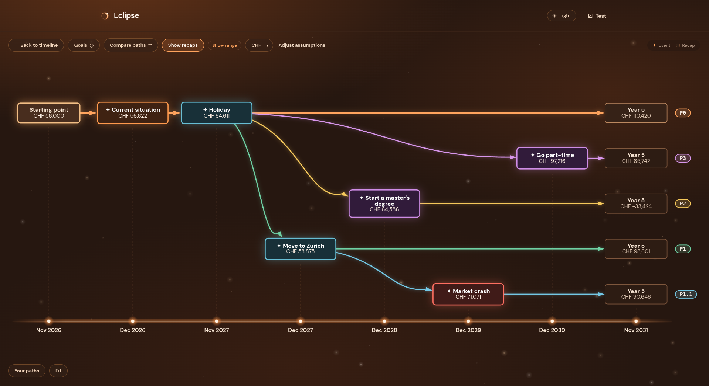

# Eclipse

Eclipse helps you compare financial paths for life decisions, such as working or returning to school. Its simulations show monthly cash balances and funding gaps, helping you understand how different assumptions affect your future.

[Visit Eclipse](https://eclipse-ai.up.railway.app/)



These are conditional simulations. Use fictional inputs and keep confidential financial information out of the tool.

## Local setup

### Start with PostgreSQL

You need Python 3.10 or later with `venv` and `pip`, Bash, and a running Docker installation with Compose. The first run needs internet access to install Python packages and download the PostgreSQL image.

1. Open a terminal in the repository root and run:

   ```sh
   ./start.sh
   ```

   The script creates `.local/venv`, installs dependencies, creates `.env` from `.env.example` if it does not exist, and starts PostgreSQL if needed. The default database listens on localhost port 5433. Startup loads the included fictional seed data into an empty database. [Fixture files](fixtures/demo) · [Sources and terms](evaluation/attributions.md)

2. Open [localhost:8000](http://127.0.0.1:8000). Leave the terminal running while you use Eclipse.

3. Press Ctrl+C in the terminal to stop Eclipse. To stop the Compose database and preserve its data, run `docker compose stop db`.

For your own PostgreSQL server, create an empty database owned by the application role, copy `.env.example` to `.env`, set `DATABASE_URL` to its connection URL, and start the database before running `./start.sh`. The role needs permission to create tables and indexes. Environment variables already exported in your shell take precedence over `.env`.

### Start without PostgreSQL

This option works on any OS, including Windows. The demos, comparisons, goals, and uncertainty ranges work without a database. Cached public education and housing presets require PostgreSQL.

1. If you previously ran `./start.sh`, remove `DATABASE_URL` from `.env` or leave its value blank. Also unset any `DATABASE_URL` exported in your shell.
2. From the repository root, install the dependencies and start the server:

   ```sh
   python -m pip install -r requirements.txt
   python -m financial_twin.server
   ```

3. Open [localhost:8000](http://127.0.0.1:8000). Press Ctrl+C in the terminal to stop Eclipse.

### Optional AI features

The fictional demos work without an AI provider key. To enable free-text story extraction and branch proposals, set `AI_API_KEY_1` in `.env` and restart. For a chat-completions-compatible service, also set `AI_BASE_URL` and a comma-separated `AI_API_KEY_MODEL` list. Native Gemini uses `GEMINI_MODEL` when the base URL is empty. [Provider setup and replay](TECHNICAL.md) · [Failure handling](FAILURE_HANDLING.md)
